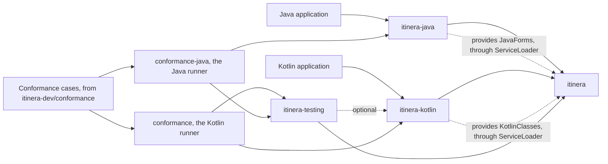
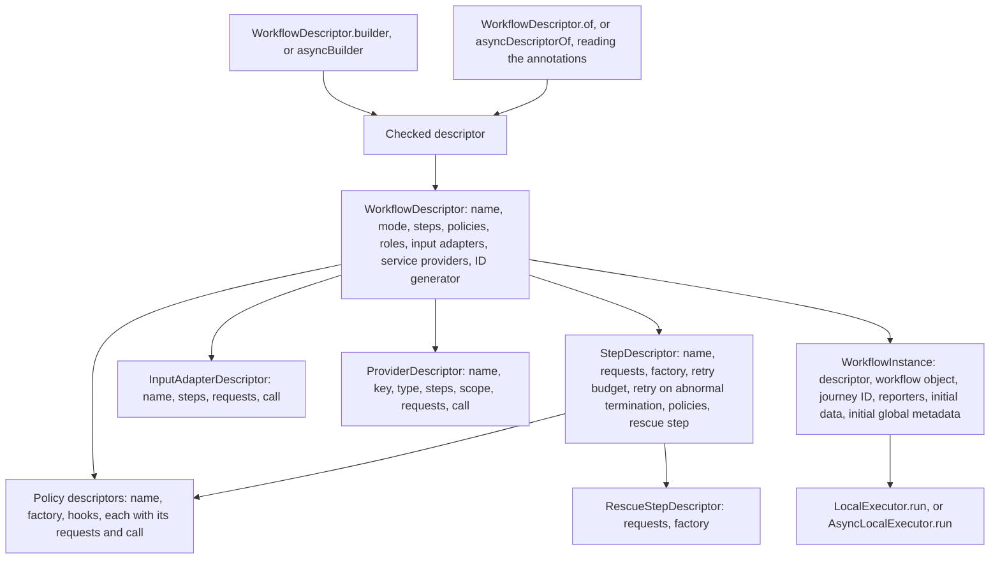
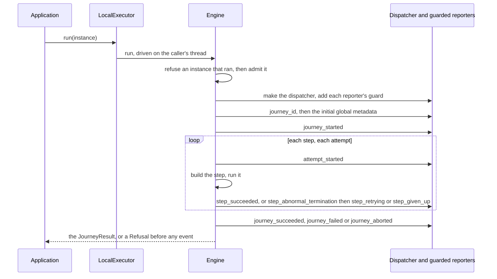

# Architecture

How itinera-j is put together, and how it runs a journey. Stage 3 of the [tier 1 plan](tier-1-plan.md) starts this document, and each later stage adds the sections of what it builds, so it never describes anything ahead of the code.

Every diagram is followed by a numbered list that says everything it shows, and by the places in the code where that part lives. The words are those of the [specification](https://github.com/itinera-dev/spec), chapter 1, and the names are those of the Kotlin code, with the Java form where it differs. Why each part is shaped the way it is, is decided in the tier 1 plan and the tech specs under [specs](specs/).

## Tier 1

Tier 1 runs a journey in one process, with steps, retries, rescue steps, policies and their hooks, roles, input adapters, services, events and reporters. So far, steps declare what they request, policies declare their hooks and what each requests, workflows declare the roles they provide, workflows declare their input adapters, all of it either with the builders or with annotations, workflows declare their service providers, either with the builders or with annotations, steps declare their rescue steps, either with the builders or with annotations, and admission refuses a service no provider gives, a service provided twice, a duplicate provider name, a service provider for an unknown step, a wrong service type, an attempt request in journey scope, a hook defined twice, a role not provided, a step adapted twice, a duplicate adapter name, an input adapter for an unknown step and a rescued step retried, though nothing resolves a request, calls a hook, calls an adapter, calls a provider or runs a rescue step yet; a journey runs steps that read no request and succeed or terminate abnormally, retries them while their retry budget lasts, gives them up, aborts when a step cannot be built, a reporter fails or custom code returns `null`, and ends with a result.

### The artifacts

1. A Java application depends on `itinera-java`, the Java face, which depends on `itinera`, the core, and brings Kotlin's standard library only. The Java face holds what Java finds awkward in the core: so far, `JavaRequests`, whose `optionalInput`, `optionalFromStep`, `optionalFromWorkflow`, `optionalReason` and `optionalError` answer with an `Optional`, and `JavaForms`, which it provides the core through `java.util.ServiceLoader`, so that a Java step's or hook's `Optional` parameter is read as an optional request. Without it, such a parameter is refused.
2. A Kotlin application depends on `itinera-kotlin`, which depends on the core and brings kotlin-reflect and kotlinx.coroutines.
3. `itinera-kotlin` provides the core with `KotlinClasses`, through `java.util.ServiceLoader`: the reader of Kotlin data classes, and of what a method or constructor of an annotated Kotlin class declares, such as `suspend`, return types admitting `null`, the classes of a return type's arguments, and each parameter's Kotlin type and name. Without it, no Kotlin class is data, and no annotated Kotlin class is read.
4. `itinera-testing`, test support, depends on the core, and on `itinera-kotlin` only as an optional dependency.
5. `conformance`, which is never published, runs the conformance cases of [itinera-dev/conformance](https://github.com/itinera-dev/conformance) in two columns, synchronous and asynchronous, through the public API of the core, `itinera-kotlin` and `itinera-testing`.
6. `conformance-java`, never published either and written wholly in Java, runs the synchronous cases through the public API of `itinera-java` and `itinera-testing`, without `itinera-kotlin`.

Each artifact is a Java module whose packages are its own, named after concepts. The core's packages are `org.itineradev.itinera` itself, which holds `ExperimentalItineraApi`, and `event`, `executor`, `instance`, `journey`, `policy`, `report`, `request`, `service`, `step`, `value` and `workflow`, under `org.itineradev.itinera`, and `engine`, which the core's module descriptor exports only to `itinera-kotlin` and `itinera-java`.

Where it lives: the Gradle projects `itinera`, `itinera-kotlin`, `itinera-java`, `itinera-testing`, `itinera-bom`, `conformance` and `conformance-java`, each module descriptor in its `src/main/java/module-info.java`.

### What a workflow is made of

1. A `WorkflowDescriptor<W, M>` holds the workflow's name, its mode `M`, `Sync` or `Async`, its step descriptors in the order they run, its `WorkflowPolicyDescriptor`s in order, the roles it provides, interfaces marked `@Role` that its workflow objects implement, its `InputAdapterDescriptor`s, its `ProviderDescriptor`s, and its `JourneyIdGenerator`, if it has one.
2. A `StepDescriptor<M>` holds the step's name, its requests in the order declared, the `StepFactory<M>` that builds it for each attempt, its retry budget, whether it retries an abnormal termination, its `StepPolicyDescriptor`s in order, and its `RescueStepDescriptor<M>`, if it has one. A request is a typed token, made by `Requests`, such as `Requests.input("amount", token)`, `Requests.service(key, type)` or `Requests.contributor()`, and declared with the step builder's `request`. The factory receives a `Got<StepKind<M>>` and reads each answer as `got[request]`, of the request's own type. Until stage 5 resolves requests, the engine gives factories a `Got` whose every read throws, saying so. A `RescueStepDescriptor<M>` holds a rescue step's requests in order and its `RescueFactory<M>`, which receives a `Got<RescueKind<M>>` and builds a run returning `RescueOutcome`, which has no skip. `RescueKind` lets a rescue step request what a step may, and also data from the rescued step, its reason and its error. `RescueStepDescriptor.builder(factory)`, or `asyncRescueStep(factory)` in `itinera-kotlin`, makes one, and the step builder's `rescue` gives it to its step, once at most. The rescue step has no name of its own: `engine/Rescues.kt` names it `<step>_rescue`, counts that name among the workflow's steps, so that a declared step of that name is `duplicate step name` and adapters and providers may be attached to it, and finds a step with both a rescue step and a retry budget above 0 as `rescued step retried`.
3. A policy descriptor, `StepPolicyDescriptor<P, M>` or `WorkflowPolicyDescriptor<P, M>`, holds the policy's name, the `PolicyFactory
` that builds it, and a `HookDefinition` for each hook it defines, `null` for the others: the hook's requests in order, made by `Requests` as a step's are, and its call, `SyncHook` or `SyncWorkflowHook`, or `AsyncHook` or `AsyncWorkflowHook` in `itinera-kotlin`, which receives the policy and a `Got` of the hook's kind and returns the hook's own type. Each hook's kind, such as `StepRetryKind<M>`, says what it may request, so a request of another kind does not compile. `StepPolicyDescriptor.builder(name, factory)` and `WorkflowPolicyDescriptor.builder(name, factory)`, or `asyncStepPolicy` and `asyncWorkflowPolicy` in `itinera-kotlin`, make them through the engine's `PolicyDraft`, which refuses a hook defined twice and a policy with no hook; the step builder's `policy` and the workflow builder's `policy` and `role` attach them.
4. An `InputAdapterDescriptor<W, M>` holds the adapter's name, an `AdapterName`, the names of the steps it is attached to, in order, its requests in order, and its call: a `SyncInputAdapter<W>`, or an `AsyncInputAdapter<W>` in `itinera-kotlin`, which receives the workflow object and a `Got<InputAdapterKind>` and returns `Supplied`, either `Supplied.Value` or `Supplied.FromDataBag`. `InputAdapterKind` lets it request the step's name, the key, data from the workflow, the journey ID and a `DataBagAccess`, which reads the data bag and has no method that writes. `InputAdapterDescriptor.builder(name, step, adapter)`, or `asyncInputAdapter` in `itinera-kotlin`, makes one attached to at least one step, and the workflow builder's `inputAdapter` adds it. An annotated workflow declares one as a method marked `@InputAdapter`, read below. `engine/Adapters.kt` finds `duplicate adapter name`, `step adapted twice` and `input adapter for unknown step`, and refuses a hand-written adapter attached to no step as misdeclared. A hand-written adapter of the other mode, which an unchecked cast hands over, or an asynchronous adapter written in Java, is refused by `run` as `Violation.Misdeclared`, since the specification gives input adapters no mode of their own.
5. A `ProviderDescriptor<W, M>`, in `service/`, is sealed: a `JourneyProviderDescriptor`, whose one instance is lent for the journey, or an `AttemptProviderDescriptor`, whose instance is lent for one attempt. Each holds the provider's name, a `ProviderName`, the key and type of the service it supplies, the names of the steps it is attached to, none when it serves every step, its requests in order, and its call: a `SyncProvider`, or an `AsyncProvider` in `itinera-kotlin`, which receives the workflow object and a `Got` of its kind and returns `Provided`, either `Provided.Instance`, with the data supplied with it, or `Provided.NoInstance`. `JourneyProviderKind` lets a provider of journey scope request the journey ID, data from the workflow and its `ProviderReporter`, and `AttemptProviderKind` adds the step's name and the attempt, so a provider of journey scope that reads either does not compile. `ProviderDescriptor.builder(name, key, type, provider)` and `ProviderDescriptor.perAttempt(...)`, or `asyncProvider` and `asyncPerAttemptProvider` in `itinera-kotlin`, make them, and the workflow builder's `provider` adds them. A provider attached to a step serves it in place of the provider of its key attached to no step, which serves every other step. `engine/Services.kt` finds, step by step, `service requested twice`, `service not provided` and `wrong service type`, and `engine/Providers.kt` finds `duplicate provider name`, `service provided twice`, through `engine/ProvidedTwice.kt`, `service provider for unknown step` and, in a hand-written provider of journey scope, `attempt request in journey scope`.
6. `WorkflowDescriptor.builder(type, name)`, or `builder<W>(name)` in Kotlin, makes a checked synchronous descriptor, refusing every violation at once with `Violations`, among them `hook defined twice` and `role not provided`, which `engine/HooksDefinedTwice.kt` and `engine/Policies.kt` find. `asyncBuilder<W>(name)` and `asyncStep(name, factory)`, in `itinera-kotlin`, make asynchronous ones, whose steps' runs are `suspend` functions.
7. `WorkflowDescriptor.of(type)` reads a class's `@Workflow`, `@WithStep` and `@IdGenerator` annotations through the same checks, once per class. Each step class, marked `@Step`, is read into a `StepClass`: its constructor's parameters, marked `@Input`, are its inputs, and its method `run`'s parameters are its services, marked `@Service`, and its handles, recognised by their types, each turned into a request by `StepRequests`. A step class's factory builds it with its constructor, passing the answers to its inputs, and calls its method `run` by reflection with the answers to its services and handles. `asyncDescriptorOf(type)`, in `itinera-kotlin`, reads a class implementing `ItineraAsyncWorkflow` the same way, and calls its `suspend` method `run` with the caller's continuation.
8. The policy classes that `@WithStep(policies = ...)` and `@Workflow(policies = ...)` name, marked `@StepPolicy` or `@WorkflowPolicy` and implementing `ItineraStepPolicy` or `ItineraWorkflowPolicy`, are read by `PolicyClasses`, each class once, into policy descriptors whose factory calls the constructor that takes nothing. `HookMethods` finds each public method marked with a hook's annotation, such as `@OnStepSuccess`, and checks its mode and what it returns; `HookRequests` turns each of its parameters into a request: data marked `@FromStep` or `@FromWorkflow`, read by `DataRequests` as a step's inputs are, roles marked `@Role`, and the rest by type, each only where the hook's kind may request it. The `HookCalls` of each mode, given by `Described` and by `itinera-kotlin`'s asynchronous reader, call a hook method by reflection, the asynchronous ones as `suspend` functions. A workflow class provides every interface marked `@Role` that it, its superclasses or their interfaces implement. `AdapterMethods` reads the methods marked `@InputAdapter` of a workflow class and its superclasses, which `MarkedMethods` finds, a method overriding another replacing it, each returning `Supplied`, which `supply` and `fromDataBag` of `ItineraWorkflow` and `ItineraAsyncWorkflow` make, `suspend` exactly when the workflow is asynchronous; `AdapterRequests` turns each parameter into a request: data marked `@FromWorkflow`, the key marked `@Key`, and the step's name, the journey ID and the data bag's access by type. The `AdapterCalls` of each mode call an adapter method on the workflow object by reflection, the asynchronous ones as `suspend` functions. `ProviderMethods` reads the methods marked `@Provider`, which `MarkedMethods` finds the same way, each returning `Provided` of the service's type, which `provide` and `noInstance` of `ItineraWorkflow` and `ItineraAsyncWorkflow` make, `suspend` exactly when the workflow is asynchronous, and of attempt scope when marked `perAttempt`; `ProviderRequests` turns each parameter into a request: data marked `@FromWorkflow`, and the journey ID, the step's name, the attempt and the provider reporter of its mode by type; `ProviderMethods` finds a provider of journey scope requesting the step's name or the attempt as `attempt request in journey scope`. The `ProviderCalls` of each mode call a provider method on the workflow object by reflection, the asynchronous ones as `suspend` functions. The rescue step class that `@WithStep(rescue = ...)` names, marked `@RescueStep` and implementing `ItineraRescueStep`, is read by `RescueClasses` into a `RescueClass`: its constructor's parameters, its inputs marked `@Input`, its data from the rescued step marked `@FromRescuedStep` and the failure's reason and error by type, are turned into requests by `StepRequests`, which reads its run's services and handles as a step's; the `StepFactories` of each mode make its factory, which builds it with its constructor and calls its `run`, which returns `RescueOutcome`.
9. A `WorkflowInstance<M>` holds the descriptor beside the application's workflow object, the journey ID, the reporters, the initial data and the initial global metadata. `instance()` on a workflow object, `InstanceBuilder.of(descriptor, workflow)`, or `AsyncInstanceBuilder.of(descriptor, workflow)` in `itinera-kotlin`, creates one.
10. `LocalExecutor.run` takes only a `WorkflowInstance<Sync>`, and `AsyncLocalExecutor.run` only a `WorkflowInstance<Async>`.

Where it lives: `workflow/` for descriptors, builders, annotations and violations, `step/` for steps and rescue steps, their factories and what they return, `@Input` and `StepReporter`, `policy/` for policy descriptors, their builders, hooks, what hooks return, `HookReporter`, `@Role` and the annotations of policy classes, `request/` for requests, their kinds and `Got`, `journey/Contributor.kt`, `journey/DataBagAccess.kt`, `service/` for service provider descriptors, their builder, what providers return and `ProviderReporter`, with `@Service`, `instance/` for instances and their builder, `engine/Checked.kt`, `engine/Described.kt`, `engine/Reading.kt`, `engine/StepClasses.kt`, `engine/RescueClasses.kt`, `engine/StepRequests.kt`, `engine/DataRequests.kt`, `engine/WrittenRequest.kt`, `engine/PolicyClasses.kt`, `engine/HookMethods.kt`, `engine/HookAnnotation.kt`, `engine/HookRequests.kt`, `engine/Failed.kt`, `engine/HookCalls.kt`, `engine/DeclaredParameter.kt`, `engine/Asked.kt`, `engine/Requested.kt`, `engine/PolicyDraft.kt`, `engine/DefinedHook.kt`, `engine/HooksDefinedTwice.kt`, `engine/Policies.kt`, `engine/Roles.kt`, `engine/Rescues.kt`, `engine/Adapters.kt`, `engine/MarkedMethods.kt`, `engine/AdapterMethods.kt`, `engine/AdapterRequests.kt`, `engine/AdapterCalls.kt`, `engine/ProviderMethods.kt`, `engine/ProviderRequests.kt`, `engine/ProviderCalls.kt`, `engine/Providers.kt`, `engine/ProvidedTwice.kt`, `engine/Shared.kt`, `engine/JavaForms.kt`, `engine/IdGenerators.kt`, `engine/Problems.kt` and `engine/Reflection.kt` for the checks and the reader, `engine/Draft.kt` and `engine/Initial.kt` for creating an instance, `engine/DataBags.kt` for data bags and adapters' access to them, `engine/Builders.kt` for the builders `itinera-kotlin` starts; in `itinera-kotlin`, `workflow/kotlin/KotlinFunctions.kt` and `value/kotlin/KotlinDataClasses.kt`, which reads Kotlin methods for the core, `workflow/kotlin/Builders.kt` for the reified builder, `workflow/async/` for `ItineraAsyncWorkflow`, the asynchronous builder and reader, `step/async/` for asynchronous steps, asynchronous rescue steps and the steps' reporter, `policy/async/` for asynchronous policies, their hooks and their reporter, `service/async/` for asynchronous providers and their reporter, `request/kotlin/` and `request/async/` for the reified requests and the asynchronous reporter's, `journey/kotlin/Reads.kt` for the reified reads of the data bag and of an adapter's access, and `instance/async/` for their instances; in `itinera-java`, `request/java/`.

### How a journey runs

1. The application calls `run` with an instance. The executor refuses a call while it runs a journey, with `Refused.JourneyRunning`. `AsyncLocalExecutor` runs the same steps in the caller's coroutine, awaiting each part; the diagram shows `LocalExecutor`.
2. The engine, driven on the caller's thread, refuses an instance that ran, then admits it with one check that finds every violation: those of a descriptor the builder did not make, a service a step requests twice, that no provider gives or whose provider supplies another type, a service provided twice, a duplicate provider name, a provider for an unknown step, a provider of journey scope requesting the attempt, a hook defined twice, a role not provided, a role the workflow object does not implement, every part of another mode, steps, rescue steps, hooks, service providers and reporters with `mode not accepted` and input adapters as misdeclared, initial values that are not values, and `journey_id` in the initial global metadata.
3. It makes the dispatcher with the executor's factory, and adds a guard for each reporter. It sets `journey_id`, then the initial global metadata. Any failure so far is a `Refusal`, with no event.
4. It emits `journey_started`, then attempts each step in order: `attempt_started`, then the step is built with its factory, given what the step requested, and run.
5. A success emits `step_succeeded`, and the next step follows. An abnormal termination emits `step_abnormal_termination`, then `step_retrying` and another attempt while `retry on abnormal termination` is on and the retry budget lasts, or `step_given_up`, then `journey_failed`.
6. Once every step succeeded, it emits `journey_succeeded`.
7. A step that cannot be built, a reporter that fails, or `null` where a result is owed aborts the journey: the abort is recorded, the first one standing, and `journey_aborted` is the last event.
8. `run` returns the `JourneyResult`: succeeded or failed with the data bag, or aborted.
9. In the asynchronous mode, when custom code throws and the coroutine running `run` was cancelled, the journey is abandoned with no further event, and the cancellation reaches the caller. The engine asks again once `journey_aborted` is delivered.

Where it lives: `executor/LocalExecutor.kt` and `executor/Refusal.kt`, and `executor/async/AsyncLocalExecutor.kt` in `itinera-kotlin`; in `engine/`, `Driven.kt` drives the engine, `Engine.kt` runs the journey, `Start.kt`, `Admission.kt`, `Modes.kt` and `Services.kt` do what comes before it, `Attempts.kt` and `Decision.kt` attempt each step and decide what follows an abnormal termination, `Journey.kt` and `Emitter.kt` make and deliver events and record the abort; the result in `journey/JourneyResult.kt`, `journey/Failure.kt` and `journey/Abort.kt`.

### The engine's seams

```mermaid
flowchart LR
    accTitle: How the one engine serves each mode
    accDescr: The engine, written once as suspend functions, calls the workflow's parts through Parts. SyncParts serves the synchronous mode and AsyncParts, in itinera-kotlin, the asynchronous one: each accepts steps, rescue steps, hooks, input adapters, service providers and reporters of its mode, refusing in the asynchronous mode a hook, input adapter, service provider or reporter written in Java, makes the dispatcher, builds steps and rescue steps, makes a step's, a hook's or a service provider's reporter of its mode, calls input adapters, service providers and hooks, awaiting them in the asynchronous mode, and says whether the journey was cancelled. The engine delivers events through Delivery, which wraps the dispatcher, and every reporter added to the dispatcher is wrapped in a Guard, which shares the journey's record of failures.
    engine["Engine"] --> parts["Parts of the mode: SyncParts or AsyncParts"]
    parts --> delivery["Delivery, around the dispatcher"]
    delivery --> guard["Guard around each reporter"]
    guard --> failures["Failures, shared by the journey's guards"]
    engine --> failures
```

1. The `Engine` is written once, as `suspend` functions, and calls a workflow's parts through `Parts`, one implementation per mode. `SyncParts` serves the synchronous mode: it says which steps, rescue steps, hooks, input adapters, service providers and reporters it accepts, makes the dispatcher with the executor's factory, builds steps, and never suspends. `AsyncParts`, in `itinera-kotlin`, serves the asynchronous mode the same way, and fills `ensureActive()` from the caller's coroutine context. It refuses a hook, an input adapter, a service provider or a reporter written in Java, which javac lets implement an asynchronous interface without its `suspend` operations, and `AsyncLocalExecutor` refuses such a dispatcher factory when it is made.
2. The engine delivers events and global metadata through `Delivery`, which wraps the journey's dispatcher.
3. Every reporter added to the dispatcher is wrapped in a `Guard`. Once any reporter failed, the guards let nothing through but `journey_aborted`, and nothing at all to the reporter that failed; a failure on `journey_aborted` is ignored.
4. The guards share the journey's `Failures`, which the engine reads after each delivery, so a dispatcher that swallows a reporter's failure still aborts the journey with `reporter failed`.

Where it lives: `engine/Parts.kt`, `engine/SyncParts.kt`, `engine/Guard.kt`, and `executor/async/AsyncParts.kt` in `itinera-kotlin`.
