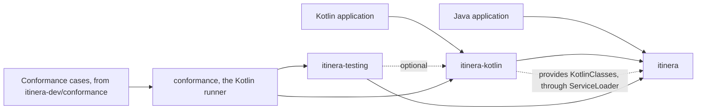
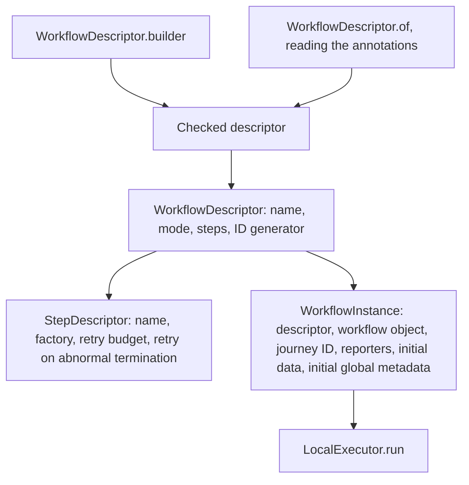
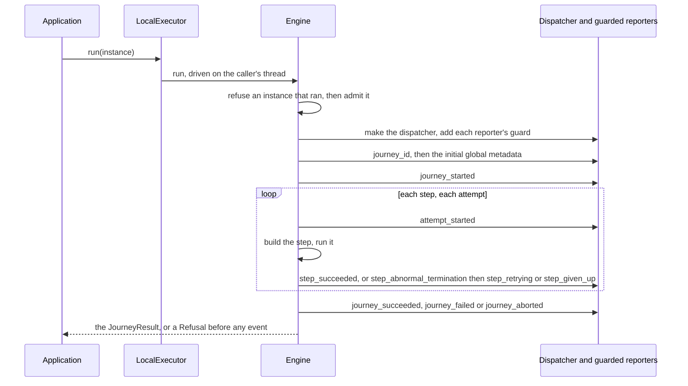
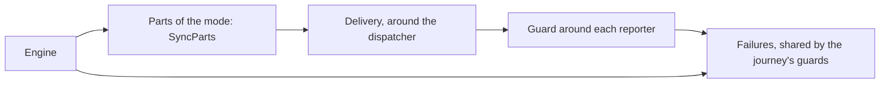

# Architecture

How itinera-j is put together, and how it runs a journey. Stage 3 of the [tier 1 plan](tier-1-plan.md) starts this document, and each later stage adds the sections of what it builds, so it never describes anything ahead of the code.

Every diagram is followed by a numbered list that says everything it shows, and by the places in the code where that part lives. The words are those of the [specification](https://github.com/itinera-dev/spec), chapter 1, and the names are those of the Kotlin code, with the Java form where it differs. Why each part is shaped the way it is, is decided in the tier 1 plan and the tech specs under [specs](specs/).

## Tier 1

Tier 1 runs a journey in one process, with steps, retries, rescue steps, policies and their hooks, roles, input adapters, services, events and reporters. So far, a journey runs steps that take no requests and succeed or terminate abnormally, retries them while their retry budget lasts, gives them up, aborts when a step cannot be built, a reporter fails or custom code returns `null`, and ends with a result.

### The artifacts

1. A Java application depends on `itinera`, the core, which brings Kotlin's standard library only.
2. A Kotlin application depends on `itinera-kotlin`, which depends on the core and brings kotlin-reflect.
3. `itinera-kotlin` provides the core with `KotlinClasses`, through `java.util.ServiceLoader`: the reader of Kotlin data classes, and of what a method of an annotated Kotlin class declares, such as `suspend` and return types admitting `null`. Without it, no Kotlin class is data, and no annotated Kotlin class is read.
4. `itinera-testing`, test support, depends on the core, and on `itinera-kotlin` only as an optional dependency.
5. `conformance`, which is never published, runs the conformance cases of [itinera-dev/conformance](https://github.com/itinera-dev/conformance) in two columns, synchronous and asynchronous, through the public API of the three artifacts.

Each artifact is a Java module whose packages are its own, named after concepts. The core's packages are `org.itineradev.itinera` itself, which holds `ExperimentalItineraApi`, and `event`, `executor`, `instance`, `journey`, `policy`, `report`, `service`, `step`, `value` and `workflow`, under `org.itineradev.itinera`, and `engine`, which the core's module descriptor exports only to `itinera-kotlin`.

Where it lives: the Gradle projects `itinera`, `itinera-kotlin`, `itinera-testing`, `itinera-bom` and `conformance`, each module descriptor in its `src/main/java/module-info.java`.

### What a workflow is made of

1. A `WorkflowDescriptor<W, M>` holds the workflow's name, its mode `M`, `Sync` or `Async`, its step descriptors in the order they run, and its `JourneyIdGenerator`, if it has one.
2. A `StepDescriptor<M>` holds the step's name, the `StepFactory<M>` that builds it for each attempt, its retry budget, and whether it retries an abnormal termination.
3. `WorkflowDescriptor.builder(type, name)` makes a checked descriptor, refusing every violation at once with `Violations`.
4. `WorkflowDescriptor.of(type)` reads a class's `@Workflow`, `@WithStep` and `@IdGenerator` annotations through the same checks, once per class. A step class's factory builds it with its constructor and calls its method `run` by reflection.
5. A `WorkflowInstance<M>` holds the descriptor beside the application's workflow object, the journey ID, the reporters, the initial data and the initial global metadata. `instance()` on a workflow object, or `InstanceBuilder.of(descriptor, workflow)`, creates one.
6. `LocalExecutor.run` takes only a `WorkflowInstance<Sync>`.

Where it lives: `workflow/` for descriptors, builders, annotations and violations, `step/` for steps and their factories, `instance/` for instances and their builder, `engine/Checked.kt`, `engine/Described.kt`, `engine/Reading.kt`, `engine/StepClasses.kt`, `engine/IdGenerators.kt`, `engine/Problems.kt` and `engine/Reflection.kt` for the checks and the reader, `engine/Draft.kt` and `engine/Initial.kt` for creating an instance; in `itinera-kotlin`, `workflow/kotlin/KotlinFunctions.kt` and `value/kotlin/KotlinDataClasses.kt`, which reads Kotlin methods for the core.

### How a journey runs

1. The application calls `run` with an instance. The executor refuses a call while it runs a journey, with `Refused.JourneyRunning`.
2. The engine, driven on the caller's thread, refuses an instance that ran, then admits it with one check that finds every violation: those of a descriptor the builder did not make, every part of another mode, initial values that are not values, and `journey_id` in the initial global metadata.
3. It makes the dispatcher with the executor's factory, and adds a guard for each reporter. It sets `journey_id`, then the initial global metadata. Any failure so far is a `Refusal`, with no event.
4. It emits `journey_started`, then attempts each step in order: `attempt_started`, then the step is built with its factory and run.
5. A success emits `step_succeeded`, and the next step follows. An abnormal termination emits `step_abnormal_termination`, then `step_retrying` and another attempt while `retry on abnormal termination` is on and the retry budget lasts, or `step_given_up`, then `journey_failed`.
6. Once every step succeeded, it emits `journey_succeeded`.
7. A step that cannot be built, a reporter that fails, or `null` where a result is owed aborts the journey: the abort is recorded, the first one standing, and `journey_aborted` is the last event.
8. `run` returns the `JourneyResult`: succeeded or failed with the data bag, or aborted.

Where it lives: `executor/LocalExecutor.kt` and `executor/Refusal.kt`; in `engine/`, `Driven.kt` drives the engine, `Engine.kt` runs the journey, `Start.kt` and `Admission.kt` do what comes before it, `Attempts.kt` and `Decision.kt` attempt each step and decide what follows an abnormal termination, `Journey.kt` and `Emitter.kt` make and deliver events and record the abort; the result in `journey/JourneyResult.kt`, `journey/Failure.kt` and `journey/Abort.kt`.

### The engine's seams

1. The `Engine` is written once, as `suspend` functions, and calls a workflow's parts through `Parts`, one implementation per mode. `SyncParts` serves the synchronous mode: it says which steps and reporters it accepts, makes the dispatcher with the executor's factory, builds steps, and never suspends.
2. The engine delivers events and global metadata through `Delivery`, which wraps the journey's dispatcher.
3. Every reporter added to the dispatcher is wrapped in a `Guard`. Once any reporter failed, the guards let nothing through but `journey_aborted`, and nothing at all to the reporter that failed; a failure on `journey_aborted` is ignored.
4. The guards share the journey's `Failures`, which the engine reads after each delivery, so a dispatcher that swallows a reporter's failure still aborts the journey with `reporter failed`.

Where it lives: `engine/Parts.kt`, `engine/SyncParts.kt`, `engine/Guard.kt`.
