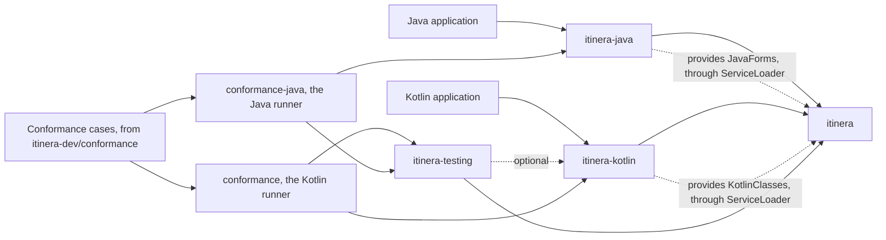
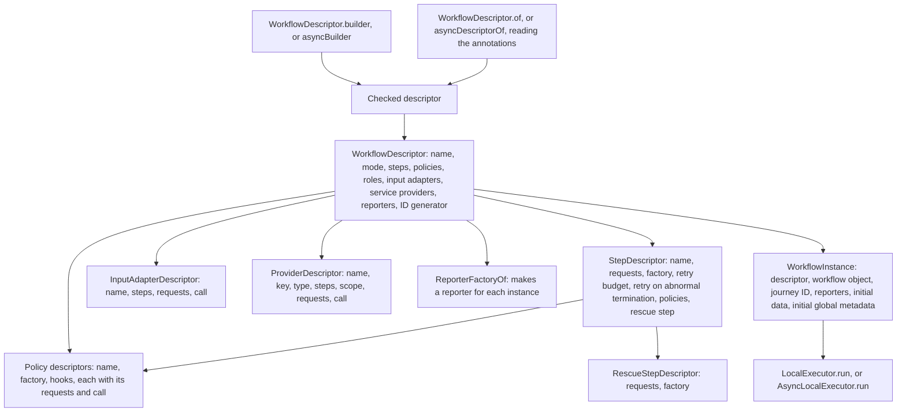
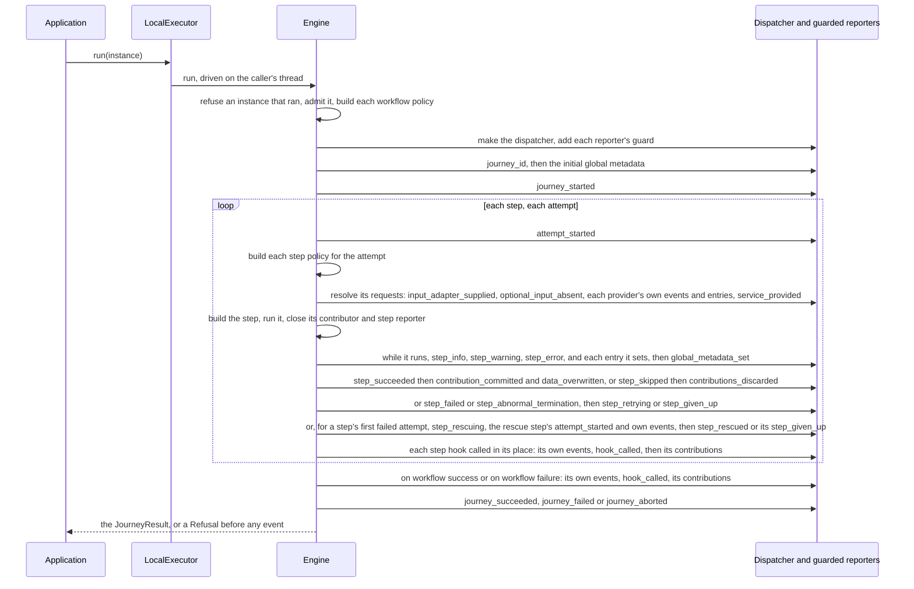

# Architecture

How itinera-j is put together, and how it runs a journey. Stage 3 of the [tier 1 plan](tier-1-plan.md) starts this document, and each later stage adds the sections of what it builds, so it never describes anything ahead of the code.

Every diagram is followed by a numbered list that says everything it shows, and by the places in the code where that part lives. The words are those of the [specification](https://github.com/itinera-dev/spec), chapter 1, and the names are those of the Kotlin code, with the Java form where it differs. Why each part is shaped the way it is, is decided in the tier 1 plan and the tech specs under [specs](specs/).

## Tier 1

Tier 1 runs a journey in one process, with steps, retries, rescue steps, policies and their hooks, roles, input adapters, services, events and reporters. So far, steps declare what they request, policies declare their hooks and what each requests, workflows declare the roles they provide, workflows declare their input adapters, all of it either with the builders or with annotations, workflows declare their service providers, either with the builders or with annotations, steps declare their rescue steps, either with the builders or with annotations, workflows list their reporters, either with the builders or with annotations, and admission refuses a service no provider gives, a service provided twice, a duplicate provider name, a service provider for an unknown step, a wrong service type, an attempt request in journey scope, a hook defined twice, a role not provided, a step adapted twice, a duplicate adapter name, an input adapter for an unknown step and a rescued step retried; a journey builds each workflow policy once and each step policy for every attempt, builds each attempt of a step from what it requests, its inputs, supplied by its input adapter or read from the data bag, its services, lent by their providers, data from the workflow, the journey ID, its name and its attempt, runs steps that succeed, fail, skip or terminate abnormally, committing what a successful attempt contributed, lets steps emit their own events and set global metadata through their step reporter, and service providers through their provider reporter, calls the hooks of their policies in the specification's order, with what each requests, its roles among it, lets a lifecycle a step hook returns finish or fail the workflow, calls the workflow hooks at the end, retries steps while their retry budget lasts, hands the first failed attempt of a step that has a rescue step to that rescue step, then attempts the step again once it succeeded, gives them up, aborts when a step or a policy cannot be built, a hook fails or returns an invalid lifecycle, something given is not a value, a reporter fails or custom code returns `null`, and ends with a result.

### The artifacts

1. A Java application depends on `itinera-java`, the Java face, which depends on `itinera`, the core, and brings Kotlin's standard library only. The Java face holds what Java finds awkward in the core: so far, `JavaRequests`, whose `optionalInput`, `optionalFromStep`, `optionalFromWorkflow`, `optionalReason` and `optionalError` answer with an `Optional`, and `JavaForms`, which it provides the core through `java.util.ServiceLoader`, so that a Java step's or hook's `Optional` parameter is read as an optional request. Without it, such a parameter is refused.
2. A Kotlin application depends on `itinera-kotlin`, which depends on the core and brings kotlin-reflect and kotlinx.coroutines.
3. `itinera-kotlin` provides the core with `KotlinClasses`, through `java.util.ServiceLoader`: the reader of Kotlin data classes, and of what a method or constructor of an annotated Kotlin class declares, such as `suspend`, return types admitting `null`, the classes of a return type's arguments, and each parameter's Kotlin type and name. Without it, no Kotlin class is data, and no annotated Kotlin class is read.
4. `itinera-testing`, test support, depends on the core, and on `itinera-kotlin` only as an optional dependency.
5. `conformance`, which is never published, runs the conformance cases of [itinera-dev/conformance](https://github.com/itinera-dev/conformance) in two columns, synchronous and asynchronous, through the public API of the core, `itinera-kotlin` and `itinera-testing`.
6. `conformance-java`, never published either and written wholly in Java, runs the synchronous cases through the public API of `itinera-java` and `itinera-testing`, without `itinera-kotlin`.

Each artifact is a Java module whose packages are its own, named after concepts. The core's packages are `org.itineradev.itinera` itself, which holds `ExperimentalItineraApi`, and `event`, `executor`, `instance`, `journey`, `policy`, `report`, `request`, `service`, `step`, `value` and `workflow`, under `org.itineradev.itinera`, and `engine`, which the core's module descriptor exports only to `itinera-kotlin` and `itinera-java`.

Where it lives: the Gradle projects `itinera`, `itinera-kotlin`, `itinera-java`, `itinera-testing`, `itinera-bom`, `conformance` and `conformance-java`, each module descriptor in its `src/main/java/module-info.java`.

### What a workflow is made of

1. A `WorkflowDescriptor<W, M>` holds the workflow's name, its mode `M`, `Sync` or `Async`, its step descriptors in the order they run, its `WorkflowPolicyDescriptor`s in order, the roles it provides, interfaces marked `@Role` that its workflow objects implement, its `InputAdapterDescriptor`s, its `ProviderDescriptor`s, the `ReporterFactoryOf<M>`s of the reporters it lists, in order, and its `JourneyIdGenerator`, if it has one. A `ReporterFactoryOf<M>`, in `report/`, makes a reporter for each instance, since reporters belong to each instance: `ReporterFactory` and `AsyncReporterFactory`, in `itinera-kotlin`, extend it, and the workflow builder's `reporter` lists one. Its `listing()`, made by `engine/Listings.kt` from the declaration alone, gives a `ListedStep` for each step in order: its name, its `Position`, its policies' names, its input adapter's name, the services it requests, each with the name of the provider that serves it, and its rescue section, if it has a rescue step.
2. A `StepDescriptor<M>` holds the step's name, its requests in the order declared, the `StepFactory<M>` that builds it for each attempt, its retry budget, whether it retries an abnormal termination, its `StepPolicyDescriptor`s in order, and its `RescueStepDescriptor<M>`, if it has one. A request is a typed token, made by `Requests`, such as `Requests.input("amount", token)`, `Requests.service(key, type)` or `Requests.contributor()`, and declared with the step builder's `request`. The factory receives a `Got<StepKind<M>>` and reads each answer as `got[request]`, of the request's own type. The engine resolves every request the step declared before it calls the factory, as "How a journey runs" says, so a read never waits; reading a request the step did not declare throws, and so does reading the step reporter, which this version does not make yet. The contributor is made for each attempt and closed when it ends. A `RescueStepDescriptor<M>` holds a rescue step's requests in order and its `RescueFactory<M>`, which receives a `Got<RescueKind<M>>` and builds a run returning `RescueOutcome`, which has no skip. `RescueKind` lets a rescue step request what a step may, and also data from the rescued step, its reason and its error. `RescueStepDescriptor.builder(factory)`, or `asyncRescueStep(factory)` in `itinera-kotlin`, makes one, and the step builder's `rescue` gives it to its step, once at most. The rescue step has no name of its own: `engine/Rescues.kt` names it `<step>_rescue`, counts that name among the workflow's steps, so that a declared step of that name is `duplicate step name` and adapters and providers may be attached to it, and finds a step with both a rescue step and a retry budget above 0 as `rescued step retried`.
3. A policy descriptor, `StepPolicyDescriptor<P, M>` or `WorkflowPolicyDescriptor<P, M>`, holds the policy's name, the `PolicyFactory
` that builds it, and a `HookDefinition` for each hook it defines, `null` for the others: the hook's requests in order, made by `Requests` as a step's are, and its call, `SyncHook` or `SyncWorkflowHook`, or `AsyncHook` or `AsyncWorkflowHook` in `itinera-kotlin`, which receives the policy and a `Got` of the hook's kind and returns the hook's own type. Each hook's kind, such as `StepRetryKind<M>`, says what it may request, so a request of another kind does not compile. `StepPolicyDescriptor.builder(name, factory)` and `WorkflowPolicyDescriptor.builder(name, factory)`, or `asyncStepPolicy` and `asyncWorkflowPolicy` in `itinera-kotlin`, make them through the engine's `PolicyDraft`, which refuses a hook defined twice and a policy with no hook; the step builder's `policy` and the workflow builder's `policy` and `role` attach them.
4. An `InputAdapterDescriptor<W, M>` holds the adapter's name, an `AdapterName`, the names of the steps it is attached to, in order, its requests in order, and its call: a `SyncInputAdapter<W>`, or an `AsyncInputAdapter<W>` in `itinera-kotlin`, which receives the workflow object and a `Got<InputAdapterKind>` and returns `Supplied`, either `Supplied.Value` or `Supplied.FromDataBag`. `InputAdapterKind` lets it request the step's name, the key, data from the workflow, the journey ID and a `DataBagAccess`, which reads the data bag and has no method that writes. `InputAdapterDescriptor.builder(name, step, adapter)`, or `asyncInputAdapter` in `itinera-kotlin`, makes one attached to at least one step, and the workflow builder's `inputAdapter` adds it. An annotated workflow declares one as a method marked `@InputAdapter`, read below. `engine/Adapters.kt` finds `duplicate adapter name`, `step adapted twice` and `input adapter for unknown step`, and refuses a hand-written adapter attached to no step as misdeclared. A hand-written adapter of the other mode, which an unchecked cast hands over, or an asynchronous adapter written in Java, is refused by `run` with `mode not accepted`.
5. A `ProviderDescriptor<W, M>`, in `service/`, is sealed: a `JourneyProviderDescriptor`, whose one instance is lent for the journey, or an `AttemptProviderDescriptor`, whose instance is lent for one attempt. Each holds the provider's name, a `ProviderName`, the key and type of the service it supplies, the names of the steps it is attached to, none when it serves every step, its requests in order, and its call: a `SyncProvider`, or an `AsyncProvider` in `itinera-kotlin`, which receives the workflow object and a `Got` of its kind and returns `Provided`, either `Provided.Instance`, with the data supplied with it, or `Provided.NoInstance`. `JourneyProviderKind` lets a provider of journey scope request the journey ID, data from the workflow and its `ProviderReporter`, and `AttemptProviderKind` adds the step's name and the attempt, so a provider of journey scope that reads either does not compile. `ProviderDescriptor.builder(name, key, type, provider)` and `ProviderDescriptor.perAttempt(...)`, or `asyncProvider` and `asyncPerAttemptProvider` in `itinera-kotlin`, make them, and the workflow builder's `provider` adds them. A provider attached to a step serves it in place of the provider of its key attached to no step, which serves every other step. `engine/Services.kt` finds, step by step, `service requested twice`, `service not provided` and `wrong service type`, and `engine/Providers.kt` finds `duplicate provider name`, `service provided twice`, through `engine/ProvidedTwice.kt`, `service provider for unknown step` and, in a hand-written provider of journey scope, `attempt request in journey scope`.
6. `WorkflowDescriptor.builder(type, name)`, or `builder<W>(name)` in Kotlin, makes a checked synchronous descriptor, refusing every violation at once with `Violations`, among them `hook defined twice` and `role not provided`, which `engine/HooksDefinedTwice.kt`, `engine/Policies.kt` and `engine/RoleViolations.kt` find. `asyncBuilder<W>(name)` and `asyncStep(name, factory)`, in `itinera-kotlin`, make asynchronous ones, whose steps' runs are `suspend` functions.
7. `WorkflowDescriptor.of(type)` reads a class's `@Workflow`, `@WithStep` and `@IdGenerator` annotations through the same checks, once per class. `ReporterClasses` reads each reporter class `@Workflow(reporters = ...)` names: one of the other mode is `mode not accepted`, and the reporter is built with its constructor that takes nothing, for each instance. Each step class, marked `@Step`, is read into a `StepClass`: its constructor's parameters, marked `@Input`, are its inputs, and its method `run`'s parameters are its services, marked `@Service`, and its handles, recognised by their types, each turned into a request by `StepRequests`. A step class's factory builds it with its constructor, passing the answers to its inputs, and calls its method `run` by reflection with the answers to its services and handles. `asyncDescriptorOf(type)`, in `itinera-kotlin`, reads a class implementing `ItineraAsyncWorkflow` the same way, and calls its `suspend` method `run` with the caller's continuation.
8. The policy classes that `@WithStep(policies = ...)` and `@Workflow(policies = ...)` name, marked `@StepPolicy` or `@WorkflowPolicy` and implementing `ItineraStepPolicy` or `ItineraWorkflowPolicy`, are read by `PolicyClasses`, each class once, into policy descriptors whose factory calls the constructor that takes nothing. `HookMethods` finds each public method marked with a hook's annotation, such as `@OnStepSuccess`, and checks its mode and what it returns; `HookRequests` turns each of its parameters into a request: data marked `@FromStep` or `@FromWorkflow`, read by `DataRequests` as a step's inputs are, roles marked `@Role`, and the rest by type, each only where the hook's kind may request it. The `HookCalls` of each mode, given by `Described` and by `itinera-kotlin`'s asynchronous reader, call a hook method by reflection, the asynchronous ones as `suspend` functions. A workflow class provides every interface marked `@Role` that it, its superclasses or their interfaces implement. `AdapterMethods` reads the methods marked `@InputAdapter` of a workflow class and its superclasses, which `MarkedMethods` finds, a method overriding another replacing it, each returning `Supplied`, which `supply` and `fromDataBag` of `ItineraWorkflow` and `ItineraAsyncWorkflow` make, `suspend` exactly when the workflow is asynchronous; `AdapterRequests` turns each parameter into a request: data marked `@FromWorkflow`, the key marked `@Key`, and the step's name, the journey ID and the data bag's access by type. The `AdapterCalls` of each mode call an adapter method on the workflow object by reflection, the asynchronous ones as `suspend` functions. `ProviderMethods` reads the methods marked `@Provider`, which `MarkedMethods` finds the same way, each returning `Provided` of the service's type, which `provide` and `noInstance` of `ItineraWorkflow` and `ItineraAsyncWorkflow` make, `suspend` exactly when the workflow is asynchronous, and of attempt scope when marked `perAttempt`; `ProviderRequests` turns each parameter into a request: data marked `@FromWorkflow`, and the journey ID, the step's name, the attempt and the provider reporter of its mode by type; `ProviderMethods` finds a provider of journey scope requesting the step's name or the attempt as `attempt request in journey scope`. The `ProviderCalls` of each mode call a provider method on the workflow object by reflection, the asynchronous ones as `suspend` functions. The rescue step class that `@WithStep(rescue = ...)` names, marked `@RescueStep` and implementing `ItineraRescueStep`, is read by `RescueClasses` into a `RescueClass`: its constructor's parameters, its inputs marked `@Input`, its data from the rescued step marked `@FromRescuedStep` and the failure's reason and error by type, are turned into requests by `StepRequests`, which reads its run's services and handles as a step's; the `StepFactories` of each mode make its factory, which builds it with its constructor and calls its `run`, which returns `RescueOutcome`.
9. A `WorkflowInstance<M>` holds the descriptor beside the application's workflow object, the journey ID, the reporters, the initial data and the initial global metadata. `instance()` on a workflow object, `InstanceBuilder.of(descriptor, workflow)`, or `AsyncInstanceBuilder.of(descriptor, workflow)` in `itinera-kotlin`, creates one, making first a reporter with each factory the descriptor lists, then those the instance builder is given. Its initial data is given key by key, as a map, or as a record or data class, which `JourneyData` turns into one key per component, named by its `@Datum` or by its name, an optional component holding nothing giving none.
10. `LocalExecutor.run` takes only a `WorkflowInstance<Sync>`, and `AsyncLocalExecutor.run` only a `WorkflowInstance<Async>`.

Where it lives: `workflow/` for descriptors, builders, annotations, violations and the listing, `step/` for steps and rescue steps, their factories and what they return, `@Input` and `StepReporter`, `policy/` for policy descriptors, their builders, hooks, what hooks return, `HookReporter`, `@Role` and the annotations of policy classes, `request/` for requests, their kinds and `Got`, `journey/Contributor.kt`, `journey/DataBagAccess.kt`, `service/` for service provider descriptors, their builder, what providers return and `ProviderReporter`, with `@Service`, `instance/` for instances and their builder, `report/ReporterFactoryOf.kt` for the factories of the reporters a workflow lists, `engine/Checked.kt`, `engine/Described.kt`, `engine/Listings.kt`, `engine/Reading.kt`, `engine/StepClasses.kt`, `engine/RescueClasses.kt`, `engine/StepRequests.kt`, `engine/DataRequests.kt`, `engine/WrittenRequest.kt`, `engine/PolicyClasses.kt`, `engine/ReporterClasses.kt`, `engine/HookMethods.kt`, `engine/HookAnnotation.kt`, `engine/HookRequests.kt`, `engine/Failed.kt`, `engine/HookCalls.kt`, `engine/DeclaredParameter.kt`, `engine/Asked.kt`, `engine/Requested.kt`, `engine/PolicyDraft.kt`, `engine/DefinedHook.kt`, `engine/HooksDefinedTwice.kt`, `engine/Policies.kt`, `engine/RoleViolations.kt`, `engine/Roles.kt`, `engine/Rescues.kt`, `engine/Adapters.kt`, `engine/MarkedMethods.kt`, `engine/AdapterMethods.kt`, `engine/AdapterRequests.kt`, `engine/AdapterCalls.kt`, `engine/ProviderMethods.kt`, `engine/ProviderRequests.kt`, `engine/ProviderCalls.kt`, `engine/Providers.kt`, `engine/ProvidedTwice.kt`, `engine/Shared.kt`, `engine/JavaForms.kt`, `engine/IdGenerators.kt`, `engine/Problems.kt` and `engine/Reflection.kt` for the checks and the reader, `engine/Draft.kt`, `engine/Initial.kt` and `engine/JourneyData.kt` for creating an instance, with `journey/Datum.kt`, `engine/DataBags.kt` for data bags and adapters' access to them, `engine/Builders.kt` for the builders `itinera-kotlin` starts; in `itinera-kotlin`, `workflow/kotlin/KotlinFunctions.kt` and `value/kotlin/KotlinDataClasses.kt`, which reads Kotlin methods for the core, `workflow/kotlin/Builders.kt` for the reified builder, `workflow/async/` for `ItineraAsyncWorkflow`, the asynchronous builder and reader, `step/async/` for asynchronous steps, asynchronous rescue steps and the steps' reporter, `policy/async/` for asynchronous policies, their hooks and their reporter, `service/async/` for asynchronous providers and their reporter, `request/kotlin/` and `request/async/` for the reified requests and the asynchronous reporter's, `journey/kotlin/Reads.kt` for the reified reads of the data bag and of an adapter's access, and `instance/async/` for their instances; in `itinera-java`, `request/java/`.

### How a journey runs

1. The application calls `run` with an instance. The executor refuses a call while it runs a journey, with `Refused.JourneyRunning`. `AsyncLocalExecutor` runs the same steps in the caller's coroutine, awaiting each part; the diagram shows `LocalExecutor`.
2. The engine, driven on the caller's thread, refuses an instance that ran, then admits it with one check that finds every violation: those of a descriptor the builder did not make, a service a step requests twice, that no provider gives or whose provider supplies another type, a service provided twice, a duplicate provider name, a provider for an unknown step, a provider of journey scope requesting the attempt, a hook defined twice, a role not provided, a role the workflow object does not implement, every part of another mode, steps, rescue steps, hooks, input adapters, service providers and reporters, with `mode not accepted`, initial values that are not values, and `journey_id` in the initial global metadata.
3. It builds each workflow policy once for the journey, in `BuiltPolicies`, then makes the dispatcher with the executor's factory, and adds a guard for each reporter. It sets `journey_id`, then the initial global metadata. Any failure so far, a workflow policy that throws or is built as `null` among them, is a `Refusal`, with no event.
4. It emits `journey_started`, then attempts each step in order: `attempt_started`, then each step policy attached to the step is built anew for the attempt, a policy that throws aborting the journey with `policy could not be built` and one built as `null` with `unexpected result`, then what the step requests is resolved, in `Building`, then the step is built with its factory, given the answers, and run. Its inputs come first, in the order declared: an input adapter attached to the step is called for each, given what it requests and an access to the data bag that reads nothing once its call returns, and what it supplies is captured and emits `input_adapter_supplied`; an input it leaves to the data bag, or one no adapter is attached for, is read from the data bag, as the receiver's own copy, and an optional input with no value is absent and emits `optional_input_absent`. Its services come next, in the order declared, each lent by the provider that serves the step: one of journey scope is called the first time a step it serves is built, and its instance is lent to every later attempt it serves, one of attempt scope is called for each attempt. Each call gets a provider reporter of its own, which closes once the provider returns, and through which it emits `journey_info`, `journey_warning` and `journey_error`, naming the provider, the step and the attempt, and sets global metadata, as a step reporter does; each call that makes an instance then emits `service_provided`, with the implementation's class name, or the declared type for an instance with no class of its own, such as a lambda's, and the data the provider supplied, captured. Data from the workflow, the journey ID, the step's name and its attempt are answered as asked.
5. The step is built and run with a contributor and a step reporter made for the attempt, in `Attempting`. The contributor keeps each value contributed, captured, the last under a key winning. The step reporter, which the mode's parts make over the attempt's `StepEmits` and which lets one call through at a time, whichever thread or coroutine makes it, emits `step_info`, `step_warning` and `step_error` with a captured copy of their data, and sets global metadata through `Journey`, which passes each entry to every reporter, then emits `global_metadata_set`; each call returns once every reporter has it. Both close once the attempt ends, the step reporter once no call is going through, after which a call throws `IllegalStateException` and changes nothing. A success emits `step_succeeded`, then commits the contributions to the data bag, each emitting `contribution_committed`, followed by `data_overwritten` when the key held a value, and the next step follows. A skip emits `step_skipped` and `contributions_discarded`, and the next step follows. A failure emits `step_failed`, with its reason, and an abnormal termination `step_abnormal_termination`; neither commits anything. Then `step_retrying` and another attempt follow while the retry budget lasts, and for an abnormal termination while `retry on abnormal termination` is on, or `step_given_up`, and the journey fails.
6. A step that has a rescue step is rescued, in `Rescuing`, when its first attempt fails or ends in an abnormal termination that `on step abnormal termination` does not give up: `step_rescuing` follows, with the cause and the rescue step's name, and `on step retry` and `on step failure` are not called. The rescue step, named `<step name>_rescue`, which the journey then names, emits its `attempt_started` for attempt 1, and is built and run in `Attempting`, as a step is, with a contributor and a step reporter of its own, its rescue factory built through the mode's `StepCaller` and its `RescueOutcome`, a success or a failure, read as `RescueEnded`. `Building` resolves what it requests: its inputs, through the input adapter attached to its own name, never its step's, or from the data bag, and what it requests from the step it rescues, from what the failed attempt left, as for a step hook, in the order declared, then its services, from the providers attached to its own name or to no step. A success emits `step_succeeded`, commits its contributions, then `step_rescued` names the step again, which is attempted once more with new step policies, and given up if that attempt fails. A failure emits `step_failed` and an abnormal termination `step_abnormal_termination`, then `step_given_up` for the rescue step, with no hook, and the journey fails, naming the rescue step. A rescue step cannot skip: `RescueOutcome` has no skip.
7. `Attempts` calls the step hooks through `Hooks`, in the order of the specification: `on step success` once the contributions are committed; `on step abnormal termination` right after `step_abnormal_termination`; `on step retry`, with its cause, before `step_retrying`; and `on step failure`, with its cause, after `step_given_up`. No hook is called after a skip. A hook's requests are resolved in the order it declares them, from the data bag, from what the attempt left, its contributions, its reason and its error, the hook's own copy of each, from the facts of the call and its roles, each a `java.lang.reflect.Proxy` forwarding to the workflow object, then it is called through the mode's `HookCaller` with a contributor and a hook reporter of its own, which close once it returns. The hook reporter emits `journey_info`, `journey_warning` and `journey_error` and sets global metadata, naming the policy and hook. Once the hook returned, `Lifecycles` checks what it returned, `hook_called` records it, and its contributions are committed. `FinishWorkflow` from `on step success` ends the journey at once as succeeded; `FailWorkflow` ends it at once as failed, giving the step up with the cause `FailWorkflow` when `on step retry` or `on step abnormal termination` returned it, and no further step hook is called for that step. Both are decided by the hook that returned them, which `Early` carries to the end of the journey.
8. At the end, with no step current, `Engine` calls `on workflow success` or `on workflow failure` the same way, then emits `journey_succeeded` or `journey_failed`, so a workflow hook's contributions are part of the result.
9. A step or a rescue step that cannot be built, because a required input or data from the workflow is missing, is of another type or is not a value, an input adapter or a provider fails, a provider gives no instance, or the factory throws, a contribution, a reason's details, an event's data or an entry of global metadata that are not a value, an entry under `journey_id`, a reporter that fails, a hook that throws, or a role operation it calls that throws, even when the hook catches it, with `hook failed`, a lifecycle a hook may not return, with `invalid lifecycle`, or `null` where a result is owed aborts the journey; a failing adapter or provider first emits `input_adapter_failed` or `service_provider_failed`: the abort is recorded, the first one standing, and `journey_aborted` is the last event. A contribution, an emit or an entry that aborts the journey ends the step at its call with the executor's signal, a private exception; once the attempt returns, whatever it did with the signal, the recorded abort stands, with no outcome fact and no commit. The same holds for a hook, which then has no `hook_called`, and for a service provider, which then has neither `service_provided` nor `service_provider_failed`, and no hook runs after an abort.
10. `run` returns the `JourneyResult`: succeeded or failed with the data bag, or aborted. Its `output` reads the data bag as a record or data class, through `JourneyData`, one key per component, and throws `OutputException` for an aborted journey, a required key that holds nothing or a value of another type.
11. In the asynchronous mode, when custom code throws and the coroutine running `run` was cancelled, the journey is abandoned with no further event, and the cancellation reaches the caller. The engine asks again once `journey_aborted` is delivered.
12. In the synchronous mode, custom code that throws `InterruptedException` fails as any throw does, and the engine remembers it; `LocalExecutor` sets the thread's interrupt flag again once the journey ends, before `run` returns or throws, so the caller still sees the interruption. A journey run inside a step keeps its own record, and sets the flag only when it returns.

Where it lives: `executor/LocalExecutor.kt` and `executor/Refusal.kt`, and `executor/async/AsyncLocalExecutor.kt` and `executor/async/EmittingAsyncReporter.kt` in `itinera-kotlin`; in `engine/`, `Driven.kt` drives the engine, `Errors.kt` rethrows an `Error` and restores the interrupt flag, `Engine.kt` runs the journey and calls the workflow hooks, `BuiltPolicies.kt` builds policies, `Hooks.kt` calls hooks, with `Hooked.kt` naming each call, `JourneyEmits.kt` its events and a service provider's, over `Emitting.kt`, `ActingOn.kt` and `OwnErrors.kt` answering requests for what the attempt left, `Lifecycles.kt` checking what a step hook returned, and `Roles.kt` lending roles, `Early.kt` says how a journey ends before its last step, `Start.kt`, `Admission.kt`, `Modes.kt` and `Services.kt` do what comes before it, `Attempts.kt` and `Decision.kt` attempt each step, emit its outcome, call its hooks and decide what follows a failure or an abnormal termination, `Rescuing.kt` runs a step's rescue step, `Attempting.kt` builds and runs one attempt of a step or a rescue step with its `Contributions.kt` and its step reporter, `EmittingReporter.kt` over `StepEmits.kt`, `Emitting.kt` and `Emits.kt`, and gives how it `Ended.kt`, `Building.kt` resolves what a step or a rescue step requests, through `Inputs.kt`, `Lending.kt`, `WorkflowData.kt` and `Call.kt`, with `RequestedBy.kt` naming who requests, and `Answered.kt` gives the answers to the part that requested them, `Journey.kt` and `Emitter.kt` make and deliver events and global metadata, commit contributions and record the abort; the result in `journey/JourneyResult.kt`, `journey/Failure.kt` and `journey/Abort.kt`, its output in `engine/JourneyData.kt` and `journey/OutputException.kt`, and in `itinera-kotlin`, `journey/kotlin/Outputs.kt` for the reified `output`.

### The engine's seams

```mermaid
flowchart LR
    accTitle: How the one engine serves each mode
    accDescr: The engine, written once as suspend functions, calls the workflow's parts through Parts. SyncParts serves the synchronous mode and AsyncParts, in itinera-kotlin, the asynchronous one: each accepts steps, rescue steps, hooks, input adapters, service providers and reporters of its mode, refusing in the asynchronous mode a hook, input adapter, service provider or reporter written in Java, makes the dispatcher, builds steps and rescue steps, makes a step's, a hook's or a service provider's reporter of its mode, calls input adapters, service providers and hooks, awaiting them in the asynchronous mode, and says whether the journey was cancelled. The engine delivers events through Delivery, which wraps the dispatcher, and every reporter added to the dispatcher is wrapped in a Guard, which shares the journey's record of failures.
    engine["Engine"] --> parts["Parts of the mode: SyncParts or AsyncParts"]
    parts --> delivery["Delivery, around the dispatcher"]
    delivery --> guard["Guard around each reporter"]
    guard --> failures["Failures, shared by the journey's guards"]
    engine --> failures
```

1. The `Engine` is written once, as `suspend` functions, and calls a workflow's parts through `Parts`, one implementation per mode. `SyncParts` serves the synchronous mode: it says which steps, rescue steps, hooks, input adapters, service providers and reporters it accepts, makes the dispatcher with the executor's factory, builds steps and rescue steps through its `StepCaller`, makes a step's `StepReporter`, a hook's `HookReporter` and a service provider's `ProviderReporter` through its `ReporterHandles`, as a `ReporterHandle` that lets one call through at a time and closes once none is going through, calls input adapters and service providers, calls hooks through its `HookCaller`, and never suspends. `AsyncParts`, in `itinera-kotlin`, serves the asynchronous mode the same way, making a step's `AsyncStepReporter`, a hook's `AsyncHookReporter` and a service provider's `AsyncProviderReporter` and awaiting each step, rescue step, adapter, provider and hook, and fills `ensureActive()` from the caller's coroutine context. It refuses a hook, an input adapter, a service provider or a reporter written in Java, which javac lets implement an asynchronous interface without its `suspend` operations, and `AsyncLocalExecutor` refuses such a dispatcher factory when it is made.
2. The engine delivers events and global metadata through `Delivery`, which wraps the journey's dispatcher.
3. Every reporter added to the dispatcher is wrapped in a `Guard`. Once any reporter failed, the guards let nothing through but `journey_aborted`, and nothing at all to the reporter that failed; a failure on `journey_aborted` is ignored.
4. The guards share the journey's `Failures`, which the engine reads after each delivery, so a dispatcher that swallows a reporter's failure still aborts the journey with `reporter failed`.

Where it lives: `engine/Parts.kt`, `engine/SyncParts.kt`, `engine/Emits.kt`, `engine/Guard.kt`, and `executor/async/AsyncParts.kt` in `itinera-kotlin`.
